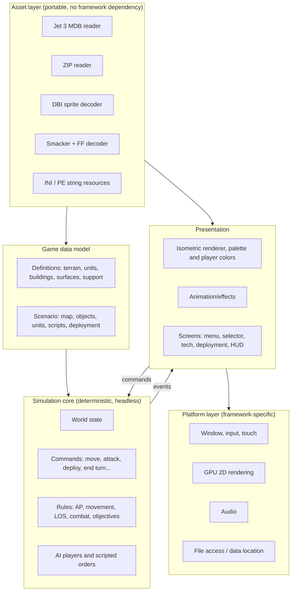

# openlibday implementation plan

Status: **draft**. Implementation language and framework: **Rust + SDL3**
(see [Technology decision](#technology-decision)).

## Goals

1. **Milestone target:** play a stand-alone skirmish from the original
   installation, end to end: selector -> technology allocation ->
   deployment -> tactical battle -> victory/defeat.
2. Run on Windows, Linux, Android and iOS from one codebase; develop on Windows.
3. Faithful to the original rules where they are known; explicit and
   replaceable where they are guessed.
4. Later: campaign/story mode, then multiplayer. The architecture must not
   block either (in particular, multiplayer needs a deterministic simulation).

Non-goals for the first milestone: campaign map/economy/research, colonies and
counterattacks, multiplayer, savegame compatibility with the original game.

## Ground rules

- **No original assets in the repository.** The engine locates a user
  installation (or a copied data folder on mobile) and reads files in place.
  Tests requiring game data are skipped when no installation is configured.
- **Lossless import.** Read every native table/field, including unknown ones,
  so later research does not require reworking loaders.
- **Evidence labels.** Each implemented rule is tagged as *native* (traced in
  disassembly), *observed* (seen in the running game), or *assumed* (our guess).
  Assumed rules are isolated so they can be replaced.
- **Mode-specific initialization.** Loading an MDB, starting a fresh battle,
  completing deployment and restoring a save are separate operations (for
  example, fresh battles reset building/wall health to type armor).

## Original data formats to support

| Data | Files | Format | Known status |
| --- | --- | --- | --- |
| Global definitions | `GLOBALS\GLOBAL.MDB` | Jet 3 (Access 97), password-protected | Schema largely read via MDB Tools |
| Player state | `GLOBALS\GAMEINFO.MDB` | Jet 3 | Campaign only; later |
| Scenarios | `SCENS\SCEN1.ZIP`, `SCEN2.ZIP`, `DEATHM.ZIP` | ZIP of Jet 3 MDBs | 22-table schema documented |
| Skirmish catalog | `SCENS\SKIRMISH.MDB` | Jet 3 | Documented |
| Sprites | `IMGS\*.DBI` | Custom: 32-byte header, BGRA palette, RLE 54x56 frames | Fully decoded for static frames |
| Unit animations | `ANMSUNIT\ANMSUNIT.FF` | `FF` container of Smacker files | **Done**: container and Smacker decoder/encoder (lossless round trip of all 5146 members); member naming and action letters documented |
| Interface | `INTERF\640X480.SMK`, `1024X768.SMK`, `PAL.BMP`, `PALCYCLE.PAL` | Smacker frames used as UI art; palette cycling | Battle HUD frames of `1024X768.SMK` mapped (`libday-view::ui`); rest unexplored |
| Video | `VIDEO\*.SMK`, `COLANMS`, `ENCYCL` | Smacker | Standard format |
| Sound | `SOUNDS\*.WAV` (+ audio in Smacker files) | PCM WAV | Standard format |
| UI strings | `EXE\LIBDAYEN.DLL` | PE string resources | Partly used |
| Configuration | `EXE\LIBDAY.INI` | INI | Documented |

Two components are required regardless of language:

- **A portable read-only Jet 3 reader.** The original uses Windows-only Jet/DAO.
  Mobile and Linux have no Jet provider, so the engine needs its own reader
  (page-based format; MDB Tools and Jackcess document it). Fallback option:
  a one-time import step that converts the installation into an open cache
  format; this is still required to run on the target device.
- **A Smacker decoder** for unit animations, interface art and videos
  (format publicly documented; FFmpeg and libsmacker implement it).

## Architecture

Key design decisions (language-independent):

- **Simulation core is headless and deterministic.** Integer/fixed-point
  arithmetic, seeded RNG owned by the simulation, no dependency on frame time
  or rendering. All player and AI actions are serializable commands.
  This enables unit tests, replays, AI self-play and lockstep multiplayer later.
- **Presentation consumes simulation events** (unit moved, shot fired, unit
  destroyed) and animates them; it never mutates world state directly.
- **8-bit palette rendering is emulated on the GPU:** indexed textures plus
  palette lookup, so player-color remapping and palette cycling stay faithful.
- **Resolution independence:** the original has 640x480 menus and a 1024x768
  tactical view. Render to a logical surface, scale to any display, and allow
  a larger tactical viewport (a long-standing limitation of the original).
- **Input abstraction:** mouse and touch map to the same actions (select,
  inspect, context command, pan, zoom). Right-button hold to inspect needs a
  touch equivalent (long press).
- **Mobile data:** users copy their installation folder; the engine checks
  for required files and reports missing ones clearly.

## Roadmap

Each milestone ends with something runnable and with automated tests.

| # | Milestone | Content | Main risk |
| --- | --- | --- | --- |
| M0 | Repository and tooling | Build, CI on Windows and Linux, data-path configuration, test fixtures that skip without game data | Low — **done**: workspace, CI, `LIBDAY_ROOT`, DBI decoder bit-exact with the Python editor on all 8 DBIs (incl. `LISTBOX.DBI`: encoding 0, no palette), SDL3 tile demo |
| M1 | Asset layer | Jet 3 reader (validated against MDB Tools/editor exports), ZIP, DBI, INI, PE strings; command-line asset dump tool | Low — **done**: Jet 3 reader matches MDB Tools on all 121 shipped databases (overflow rows: targets carry the deleted flag; tdef row counts can be stale), ZIP (stored/deflate, CRC-checked), PE `RT_STRING`, CP1252; `libday` CLI `mdb-*`, `zip-list`, `strings` |
| M2 | Map viewer | Render any skirmish map: terrain, buildings, roads/bridges, walls, decors, units, deployment zones; pan/zoom; matches the existing Python editor output | Low — **done**: `libday-view` scene + compositor, SDL viewer (`openlibday`), `libday map-scene`/`map-render`/`skirmishes`; draw list identical to the Tk editor canvas on all 47 skirmishes (`tools/modding/test_engine_parity.py`). Note: unit tech levels run 0..=10 in GLOBAL.MDB |
| M3 | Animation and interface assets | FF container and Smacker decoding; unit idle/move/attack animations; UI art from interface Smacker files; palette cycling; WAV playback | FF/Smacker codecs done early (asset editor); UI art layout is undocumented |
| M4 | Screen flow | Main menu, skirmish selector, technology allocation, deployment (budget, zones), battle shell, HUD, minimap | UI layout must be measured from the original — **battle HUD started**: sidebar/bottom bar from `1024X768.SMK` frames (`libday-view::ui`), minimap and MAP overview with per-player unit lists (`minimap`), GOAL dialog, resizable viewport (decorative right column of the sidebar cut), UI scale (default 2x) and `openlibday.ini` options; action buttons are not wired up yet |
| M5 | Core simulation | Turns, action points, movement costs, pathfinding, occupancy, reinforcements, scheduled support events | **Rules are largely unknown**; needs research track |
| M6 | Combat | Range, line of sight, accuracy, damage/armor, overwatch/autofire, destruction, wrecks, mines | Unknown formulas |
| M7 | AI and objectives | Scripted AI orders, skirmish AI, objective presets, win/loss, turn limits | Unknown AI behavior; an initial AI can be ours rather than native |
| M8 | Skirmish release | Sound, polish, settings, Linux and Android/iOS builds, touch controls | Mobile UI ergonomics |

After M8: campaign (map, economy, research, alternate maps, colonies,
counterattacks), save/load, then multiplayer (lockstep over the deterministic
simulation). Multiplayer compatibility with the original executable is not a goal.

## Research track (runs alongside M3-M7)

Large parts of the simulation are not yet reverse engineered (see "What
remains unknown" in the knowledge base). For each rule area:

1. Read relevant `GLOBAL.MDB` fields and the game manual (`manual.PDF`).
2. Trace the native code in the existing disassembly (Ghidra/x32dbg where needed).
3. Observe the running original through the Windows MCP controller on
   controlled test scenarios built with the map editor (for example, one
   unit attacking one wall, measured over repeated trials).
4. Write the finding as a short spec with its evidence label, plus a
   test fixture/expected result, before implementing it.

Order of research follows the roadmap: movement/AP and pathfinding first,
then combat formulas, then AI. Where research stalls, ship a clearly labeled
*assumed* rule so the game becomes playable and iterate.

## Testing strategy

- Unit tests for every decoder, with golden outputs compared against the
  Python editor's decoding (same sprite pixels, same table rows).
- Headless simulation tests from scripted scenarios: given commands, assert
  resulting state and events.
- Determinism tests: replay the same command log twice and compare state hashes;
  run on Windows and Linux in CI to catch platform divergence.
- Rendering snapshot tests against reference images captured from the editor
  and, where available, the original game.

## Technology decision

**Decision: Rust + SDL3.** Planned workspace layout:

| Crate | Role | Depends on SDL |
| --- | --- | --- |
| `libday-formats` | Jet 3, ZIP, DBI, FF/Smacker, INI, PE strings; decoders plus DBI/FF/Smacker encoders for modding | No |
| `libday-data` | Typed definitions and scenarios, lossless raw rows | No |
| `libday-sim` | Deterministic headless simulation, commands, events, AI | No |
| `libday-tools` | Command-line asset dump/inspection and golden-output generation | No |
| `openlibday` | Game binary: SDL3 platform, rendering, audio, UI | Yes |

Only the game binary depends on SDL3, so decoders and simulation build and test
anywhere (including CI without a display). The options considered were:

Requirements: Windows, Linux, Android and iOS;
2D sprites with palette shaders; audio; good testability of a headless core;
long-term maintainability for an open-source project.

| Option | Strengths | Weaknesses |
| --- | --- | --- |
| **C++20 + SDL3** | Proven model for faithful game reimplementations (DevilutionX, OpenXcom); SDL3 is the most mature mobile/desktop layer; easy to reuse C libraries | Manual memory safety; slower development; build tooling (CMake, vcpkg) more work |
| **Rust + SDL3** (or miniquad) | Memory safety, strong compiler checks, cargo build/test, simple cross-compilation, WebAssembly possible | Mobile packaging less mature than C++; SDL3 Rust bindings newer |
| **C# (.NET) + MonoGame/FNA** | Productive, good tooling, MonoGame supports Android/iOS | Heavier runtime on mobile; .NET SDK not currently installed (runtime only) |
| **Godot 4** | Fast UI building, built-in mobile export, editor tooling | Large engine dependency; palette/8-bit pipeline and deterministic simulation still custom; less control over faithful presentation |
| **TypeScript + PixiJS** (Capacitor for mobile) | Runs in browsers too; fast iteration | Accessing the user's installation files is awkward, especially on mobile; weaker determinism guarantees |

License: **MIT** (see `LICENSE`). The license covers openlibday's code only;
original game data remains the property of its rights holders.
