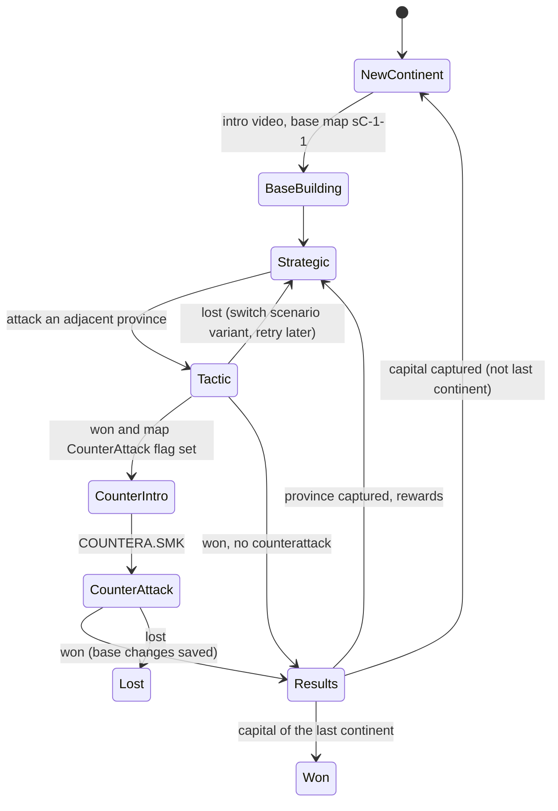

# Campaigns

This document records how the original campaign works (reverse-engineered
from `LIBDAY.EXE`, addresses refer to `modding/archive/libday.disasm.txt`),
which parts are data and which are engine code, and the plan for a
data-driven campaign interpreter in openlibday that can run the original
campaign and custom ones.

Status: **C1 (data model, importer, CLI) is done**; later milestones are
planned below. Claims marked *unverified* still need a disassembly trace
before they are implemented.

## 1. The original campaign at a glance

A campaign is four continents played in order. Each continent is a graph
of provinces. Province 1 (`PlayerCity`) is the player's base, the
`AlienCity` province is the capital; capturing it ends the continent.



### Campaign mode states (`CServerModeCampaign`, vtable `0x4B913C`)

The mode keeps its state at `+0x30`, the active phase object at `+0xC`,
the continent index at `+0x10`, the selected province at `+0x3C` and the
loaded tactical scenario at `+0x40`. `+0x34` selects a saved game
(`colony.mdb`/`city.mdb` from the save directory) instead of the shipped
data.

| State | Name | Entered at | Notes |
|---|---|---|---|
| 0 | first colony | ctor | Campaign start |
| 1 | first city attack | `0x47EFD3` | First base phase of the campaign |
| 2 | new colony | `0x47F093` (`0x47F07E`) | Plays the continent intro (`CServerPhaseAnim`, name table `0x4B9100`), loads the base map |
| 3 | strategic | `0x47F146` (`0x47F136`) | `CServerPhaseStrat` (vtable `0x4AFA64`): province map, base building, attack |
| 4 | tactic | `0x47F247` | `CServerPhaseCampaignTactic` on `sC-P-V.mdb` |
| 5 | pre counter attack | `0x47F391` | `CServerPhaseAnim("CounterA")` = `VIDEO\COUNTERA.SMK` |
| 6 | counter attack | `0x47F433` | `CServerPhaseCounterAttTactic` (vtable `0x4B962C`) on the base map |
| 7 | strategic results | `0x47F577` | `CServerPhaseStratResults` (ctor `0x4814A6`) |
| 8 | game won | `0x47DD46`, `0x47DDE8` | |
| 9 | game lost | — | No direct write found; see the exceptions below |

### Tactic result (`0x47F2E5`)

* **Lost**: `0x47E960` flips the province variant (`v + 1 > 2 → 1`), then
  back to state 3. The province can be attacked again, on the other map.
* **Won**: `0x47E6F1(credits)` copies four per-player tactical values back
  into the campaign players (`0x47D90B/915/91F/929`) and **adds** a tactic
  total (`0x41B07A`, a sum over the tactic's objects) to campaign-player
  `+0xC` (`0x47D4A6`). Then:
  * if the won scenario's `Scenario Info.CounterAttack` is set
    (scenario byte `+0xA0`, read at `0x43E646`/`0x43F3AB`, getter
    `0x44044A`) → state 5 → state 6;
  * otherwise → state 7.

**The counterattack is deterministic per scenario map**, not random: it
is the `CounterAttack` flag of the variant that was won. Because a loss
switches the variant, whether a province triggers a counterattack can
depend on which variant was played (e.g. `s1-2-1` yes, `s1-2-2` no). No
difficulty or `rand()` gate was found on this path.

### Counterattack (states 5-6)

* State 6 (`0x47F423`) runs the zone generator in AI mode
  (`0x47E677` → `0x47F8E7(1)`), rebuilds the base map file name from
  `PlayerCity` (`0x47A999` with `0x47AA20` = continent `+0x88`) and starts
  `CServerPhaseCounterAttTactic` (ctor `0x480FA9`).
* The attackers are the won scenario's `Counter Attack` table rows
  (`type`, arrival `turn`; `posX/posY` are always 0, `order` false). The
  scenario object at mode `+0x40` is the won province, the battlefield is
  the base map.
* Result (`0x47F4D7`): **won** → `0x47E82A` persists the base
  (`0x47FE73`, `0x47FC72`, `0x47FE02`, `0x47FE24`, `0x47FD7D`: buildings,
  terrain changes, roads/walls/mines — *field mapping unverified*), then
  `0x47E6F1(0)` and state 7. **Lost** → throws the string
  `"Counter Attack failure"` (`0x4B9224`, `_CxxThrowException` `0x49B6F0`).
  The application layer then ends the campaign; `0x4115FF` picks
  `FH2End` or `FH2Lose` from a won flag (`[app+0x84]`).
* AI-first turn order and the "deployed units except defence towers have
  no AP on the first AI turn" rule live in the CounterAttTactic overrides
  (`0x481100`, `0x4812A2`, `0x481311`, `0x481418`, `0x480FC8`) — *the exact
  checks are unverified*.

### Strategic results (state 7, `0x47E862`, `0x47F5CA`)

* `0x42D6C5(province, 1)` marks the province captured.
* Every campaign player receives
  `trunc(Province.Credits × pct(difficulty) × 0.01)` added to
  campaign-player `+0x8` (`0x415653`). `pct` interpolates between two
  game-settings percentages (`0x42A7D1`: `lo + (hi - lo) × d / 10`). Each
  player gets the full amount; nothing is split.
* Province record layout from `0x47B6FF`: `+0x4` number, `+0x8` Credits,
  `+0xC` Tech. *Where `Tech` is granted is unverified* (readers at
  `0x47D0CA`, `0x47D396`).
* Then (`0x47F5CA`): if the province is not `AlienCity` (`0x47AA2F` =
  continent `+0x8C`) → state 3. If it is the capital and the continent
  index is 3 → throws `"Tactical End Game failure"` (`0x4B923C`), which the
  application treats as the end of the campaign (won, `FH2End`). Otherwise
  `0x47E921` advances the continent (`+0x10 += 1`), loads the next
  continent database and base map (`0x47E077`, `0x47E164`), shows the
  continent screen (`0x47E99F`) and enters state 2.

### Scenario variants

Every non-base province has two maps, `SCEN1\sC-P-1.mdb` and
`SCEN2\sC-P-2.mdb` (format `SCEN%d\s%d-%d-%d.mdb`, `0x4B8D38`, built by
`0x47A999`). The variant is chosen per province with `rand() % 2 + 1` when
a continent starts (`0x47E269`); the base (`PlayerCity`) is forced to
variant 1. `Province List Captured.RandomChosen` stores the choice in
saves.

### Deployment points (`0x47D4E7`)

Points come from what the player owns: the HQ gives 50 once and each
Deploy Mk1-4 building (types 131/173/174/175) gives 100/110/120/130. The
sum is scaled by the continent's `DeployEasy`/`DeployHard` percentage
interpolated by difficulty (`0x47AA4D`, `DeployAvg` is unused) and by a
player-count factor (`0x41EF17`: 100/75/65/55 % for 1-4 players).

### Deployment zones (`0x47F8E7`, `0x47C350`)

The zone grid (`0x47C350`) marks blocked terrain (0x100, `0x47C3FD`),
building footprints (`0x47C55C`: transformable ones by owner as
0x40/0x50/0x60/0x70, others as 8/0xA/0xC/0xE), other objects (0x100) and
units by owner (0x40...). The player zone (`0x47C6BB`) is every unmarked
tile within Chebyshev 3 of a player building (value 8). The AI zone
(`0x47C737`) is every unmarked tile with no 0x40-bit tile within 11 (map
corners, x and y within 2 of an edge, are exempt) but some within 14.

`0x47F8E7(1)` places the Counter Attack roster (its rows have no position):
the AI tiles are collected row-major (`0x47C931`) and shuffled (for each i,
swap with `rand() % n`, `0x4412F3`); each unit takes the first tile it may
stand on (`0x42CF18`), and that tile and its 8 neighbours leave the list
(`0x47CEAE`). Units with type field +0x30 in {4, 6} are placed after the
others (`0x47CBF2`; not reproduced).

### Defence towers (`0x47FB4E`)

Buildings whose type has `transformIntoUnit` (types 100-103, loaded at
`0x424A70` into +0x28, tested by `0x429550`) become that unit for the
owner on the same tile, after the attackers are placed. Only base battles
do this (`0x47E5BE`); in other scenarios towers stay buildings. Surviving
player towers are stored back as tower buildings in the base layout.

## 2. Data sources

### Continent databases (`COLONIES\COLONIES.ZIP`: `C1.mdb`-`C4.mdb`)

The database names are hard-coded (`0x4B9118`-`0x4B9130`, array
`0x4EFDF0`).

| Table | Columns used |
|---|---|
| `Continent Info` | `No Continent`, `Provinces`, `StartCash`, `Name{English,German,French}`, `PlayerCity`, `AlienCity`, `AiAutoUnitChanceCall`, `AiAutoUnitRes`, `Intro`, `End`, `SmackProvinces`, `SmackProvFrameBegin`, `SmackProvFrameQty`, `DeployEasy`, `DeployAvg`, `DeployHard` |
| `Province List` | `NoProvince`, `ProvinceName*`, `Description*`, `Title*`, `Objective*`, `MapSize`, `TerrainType`, `mapScreen1-4` (176×176 8-bit preview bitmaps), `Credits`, `Tech`, `Anim` (always NULL) |
| `Province List Captured` | `NoProvince`, `Captured`, `RandomChosen` (initial and saved state) |
| `Adjacent Provinces` | `ProvinceNo` → `AdjacenTo` (directed; a few links appear in one direction only) |
| `Buildings Available` | `buildingType` |
| `AI automated available` | `Enum` |

| | C1 Ghoikhi-Bhaak | C2 Anstasia | C3 Quaban | C4 Nu Babel |
|---|---|---|---|---|
| Provinces | 7 | 12 | 15 | 20 |
| StartCash | 625 | 1600 | 6000 | 12000 |
| Capital | 7 | 12 | 15 | 20 |
| AI auto chance/res | 10/60 | 25/320 | 33/600 | 40/1500 |
| Deploy E/A/H % | 130/70/70 | 125/100/75 | 130/100/90 | 140/100/90 |
| Intro / End | Intro1 / End1 | Intro2 / End | Intro3 / End | Intro4 / End |

`End1`/`End` videos do not ship; the game's final video is the
hard-coded `FH2End`. `libday campaign-info` prints the full table.

### Province scenarios

`Scenario Info` adds `CounterAttack` (bool), `Credits`,
`One Off Deployment` and `ReinfRes`; the `Counter Attack` table holds the
counterattack roster. 46 of the 104 campaign province maps have
`CounterAttack = true`. Some maps without the flag still carry a roster
(13 maps, e.g. `s3-3-1` and most of C4's `-1` variants), which the original
ignores.

## 3. Hard-coded versus data

| Engine (hard-coded in the original) | Data |
|---|---|
| Exactly four continents, `C1..C4.mdb` | Continent names, start cash, deploy %, AI automated params, available buildings |
| Two variants per province in `SCEN1/SCEN2.ZIP`, random choice, swap on loss | Province names/texts, map size, terrain, previews, rewards, adjacency |
| Base is province `PlayerCity` with variant 1; capital = `AlienCity` | Which provinces are base and capital |
| Last continent = index 3 | Counterattack flag and roster per map |
| Videos `FH2Intro`, `CounterA`, `FH2End`, `FH2Lose` | Continent intro video name, province-map animation |
| HQ/Deploy Mk point values, player-count factors | Building types (`GLOBAL.MDB`) |
| Zone rules (radius 3, AI band 11-14 from units and towers) | Map content (`sC-P-V.mdb`) |
| Reward formula (difficulty percentage of Province Credits) | Province Credits and Tech |

## 4. openlibday campaign format

A campaign is a JSON document (`campaign.json`) next to its scenario
databases. The original campaign is imported into the same model at run
time (`libday_data::campaign::Campaign::import_original`); the game files
are never redistributed. `libday campaign-export out.json` writes it for
inspection or as a template.

```json
{
  "format": 1,
  "name": { "en": "Liberation Day" },
  "videos": { "counter_attack": "CounterA", "won": "FH2End", "lost": "FH2Lose" },
  "continents": [{
    "id": "C1",
    "name": { "en": "Ghoikhi-Bhaak" },
    "start_cash": 625,
    "base_province": 1,
    "capital_province": 7,
    "intro_video": "Intro1",
    "end_video": "End1",
    "map_animation": { "file": "C1", "first_frame": 0, "frames": 30 },
    "deploy_percent": { "easy": 130, "average": 70, "hard": 70 },
    "ai_automated": { "chance": 10, "resources": 60, "types": [14, 7] },
    "buildings": [100, 110, 131],
    "provinces": [{
      "number": 2,
      "name": { "en": "Eagle Nest" },
      "title": { "en": "..." }, "description": { "en": "..." }, "objective": { "en": "..." },
      "map_size": 48, "terrain": 0,
      "credits": 400, "tech": 250,
      "adjacent": [4],
      "captured": false,
      "scenarios": [
        { "variant": 1, "file": "s1-2-1.mdb", "counter_attack": true, "credits": 550,
          "counter_attack_units": [{ "type": 10, "turn": 0 }, { "type": 10, "turn": 1 }] },
        { "variant": 2, "file": "s1-2-2.mdb", "counter_attack": false, "credits": 550 }
      ]
    }]
  }]
}
```

Rules:

* `adjacent` lists the directed rows of the original; the interpreter
  treats links as undirected (`Continent::neighbours`), which matches the
  intended maps (*the strategic eligibility check is unverified*).
* `scenarios` may hold any number of variants; the interpreter picks one
  at random per continent and moves to the next on a loss (the original's
  1↔2 swap generalised).
* `Campaign::validate` checks base/capital/adjacency references and that
  every province has a scenario.
* Planned additions (later format versions, defaulting to the original
  rules): reward percentages per difficulty, deployment point values,
  zone radii, and an optional `cutscenes` list per continent transition.

## 5. Interpreter design

`libday-sim` gains a `campaign` module with a pure state machine driven by
the game client, mirroring the original states:

```text
CampaignState { campaign_id, continent, difficulty, players: [CampaignPlayer],
                provinces: [ProvinceState { captured, variant }],
                base: BaseLayout, phase: Phase }
Phase = NewContinent | Strategic | Tactic { province, variant }
      | CounterAttack { province } | Results { province } | Won | Lost
```

* `CampaignPlayer`: credits, tech points, per-unit tech levels (the
  original's `Player Campaign Tech`), statistics.
* `BaseLayout`: the base map plus buildings, roads, walls, mines and
  terrain changes made by base building and battles; it is applied on top
  of `sC-<base>-1.mdb` whenever the base is shown or defended.
* Each transition is a function (`attack`, `tactic_finished(result)`,
  `counter_attack_finished(result)`, `results_done`) so it can be unit
  tested without the UI and saved/loaded at any state as versioned JSON
  (like battle saves).
* Base building reuses the deployment UI: placement validation of
  buildings/towers/roads/walls/mines on the base map, costs from
  `GLOBAL.MDB`, budget from `StartCash` and rewards.

## 6. Milestones

| # | Scope | Status |
|---|---|---|
| C1 | Data model, original importer, JSON format, `libday campaign-info`/`campaign-export`, tests | **Done** |
| C2 | Campaign state machine and saves (`libday-sim::campaign`), new-campaign menu entry, continent/province screen (COLANMS animation, previews, adjacency, captured state) | Main menu, NEW GAME dialog (name, difficulty 0–10), campaign state and saves (`openlibday::campaign`, `saves/campaign.json`), LOAD CAMPAIGN done; continent screen done (`openlibday::strategic`, `libday_view::continent`): animated `COLANMS\Cn.SMK` sea, selected/captured province overlays, province text and credits, adjacency ("Province is too far."), INTELLIGENCE (hint with a Satellite Uplink), ATTACK, "You are victorious" + CONTINUE |
| C3 | Base-building mode on the base map (buildings, towers, roads, walls, mines; costs, refunds) | **Done** (`openlibday::base_editor`, rules in `libday_view::base`): CONTINUE/BACK on the continent overview open the editor; BUILDINGS/DEFENSES lists from the owned-building tech tree, red ghost preview with refusal messages (HQ ring, adjacency to own roads, spacing, terrain, cost), road/wall segments built to the first refused tile, MOVE, RECYCLE (full refund this session, confirm and recycle value otherwise), CAMPAIGN returns to the continent keeping the layout |
| C4 | Attack flow: army selection/deployment points, campaign tactic, results screen, rewards, variant swap on loss | Campaign tactic, capture, credit rewards, variant swap on loss done; army selection pending |
| C5 | Counterattack: COUNTERA video, roster as AI reinforcements, AI-first turn, 0-AP rule, persistence of base damage | First base attack done (`scripts/campaign.txt`): base map with the other HQs removed, troopers deployed in a radius-3 zone around the HQ, Counter Attack roster scattered 12–14 tiles from the zone (11 from units and towers) moving first, defence towers as player units, 150 tech on a win, campaign over on a loss |
| C6 | Continent transitions, intro/end videos, game won/lost | |
| C7 | Tech/research spending between battles | |

## 7. Open questions

1. Is `StartCash` added to or replacing the player's credits on a new
   continent, and do tech levels carry over? (`0x47D490` sets,
   `0x47D4A6` adds; the StartCash call site at `0x479FA7` is not traced.)
2. Where `Province.Tech` is granted and how tech points are spent
   (`Player Campaign Tech`).
3. What the tactic total from `0x41B07A` is (sum of building values?) and
   what the four copied per-player values are.
4. Exact counterattack rules: AI-first turn, which units keep AP
   (defence towers), arrival of roster rows with `turn > 0`, unit tech
   levels, owner, and how the AI zone cells are picked.
5. The strategic eligibility rule: adjacency to any captured province,
   and whether one-way adjacency rows matter.
6. Base-building costs and refunds (README: mines 10/20 credits, 50 %
   recycle refund — unverified).
7. The "first city attack" state 1: whether the base map is played as a
   battle at the start of each continent (`s1-1-1` has a 99-turn "defend"
   scenario) or only shown for building.
